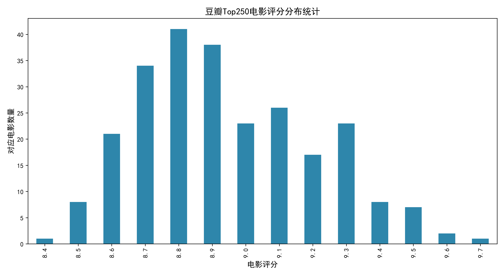
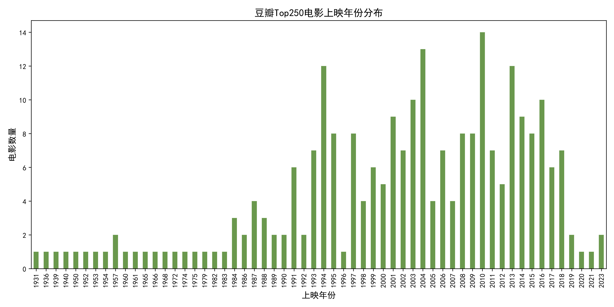

# 豆瓣电影 Top250 数据分析工具

一个基于 Python 的豆瓣电影 Top250 数据爬取与可视化分析工具。自动爬取榜单全部 250 部电影数据，生成 Excel 报表、统计图表、简介词云，并输出一份完整的 HTML 数据分析报告。

## 功能特性

- **数据爬取**：requests + BeautifulSoup 爬取豆瓣 Top250 全部 10 页数据（排名、电影名、评分、一句话简介、导演年份信息），内置请求头伪装与访问频率控制
- **Excel 导出**：爬取结果一键导出为 `豆瓣电影Top250.xlsx`
- **评分分布可视化**：matplotlib 生成评分分布柱状图（300dpi 高清输出）
- **年份统计分析**：正则提取上映年份，生成年份分布图
- **简介词云**：基于 wordcloud 生成电影简介关键词词云
- **HTML 分析报告**：自动整合所有图表，生成可直接用浏览器打开的静态报告页面
- **交互式菜单**：支持分步执行或一键完整流程，运行前自动清理旧产物

## 运行环境

- Python 3.10+
- 依赖见 [requirements.txt](requirements.txt)

## 安装与运行

```bash
# 克隆仓库
git clone https://github.com/Y-del-bot/douban-top250-analysis.git
cd douban-top250-analysis

# 建议创建虚拟环境
python -m venv .venv
.venv\Scripts\activate        # Windows
# source .venv/bin/activate   # macOS / Linux

# 安装依赖
pip install -r requirements.txt

# 运行
python douban.py
```

运行后按提示输入数字选择功能：

| 选项 | 功能 |
|------|------|
| 1 | 仅爬取电影列表，导出 Excel |
| 2 | 爬取数据 + 评分分布柱状图 |
| 3 | 爬取数据 + 年份统计 + 简介词云 + 分析报告 |
| 4 | 一键执行全部完整流程（推荐） |

## 输出产物

| 文件 | 说明 |
|------|------|
| `豆瓣电影Top250.xlsx` | 250 部电影的结构化数据表 |
| `评分分布.png` | 评分分布柱状图 |
| `年份分布.png` | 上映年份分布图 |
| `简介词云.png` | 电影简介关键词词云 |
| `数据分析报告.html` | 整合所有图表的综合分析报告 |

## 示例效果

**评分分布统计**



**上映年份分布**



**综合分析报告**：查看 [docs/数据分析报告.html](docs/数据分析报告.html)

## 注意事项

- 生成词云需要中文字体文件，默认使用 `simhei.ttf`（黑体）。Windows 可从 `C:\Windows\Fonts` 复制到项目目录，或将 `douban.py` 中 `font_path` 改为字体的绝对路径。
- 程序已内置 1.1 秒访问间隔，请勿调小，以免被豆瓣限制访问。
- 本项目仅用于学习交流，请遵守豆瓣网站的 robots 协议与相关使用条款。

## 技术栈

Python · requests · BeautifulSoup4 · pandas · matplotlib · wordcloud · openpyxl
